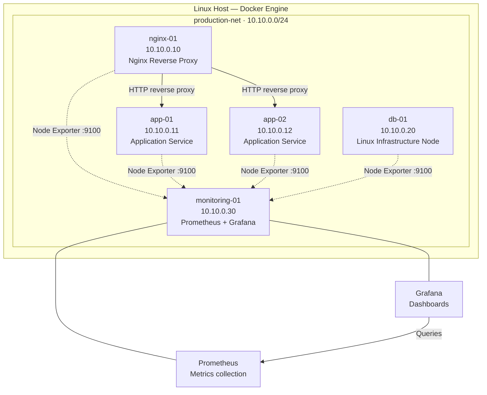
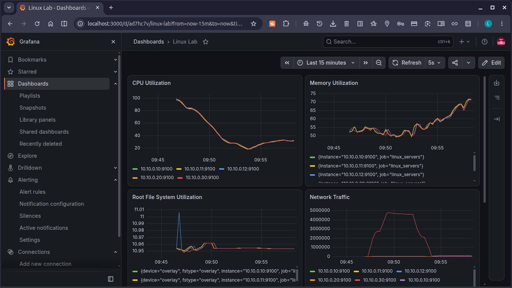
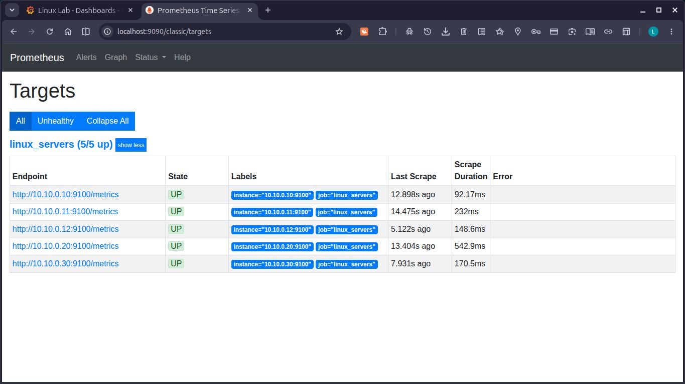
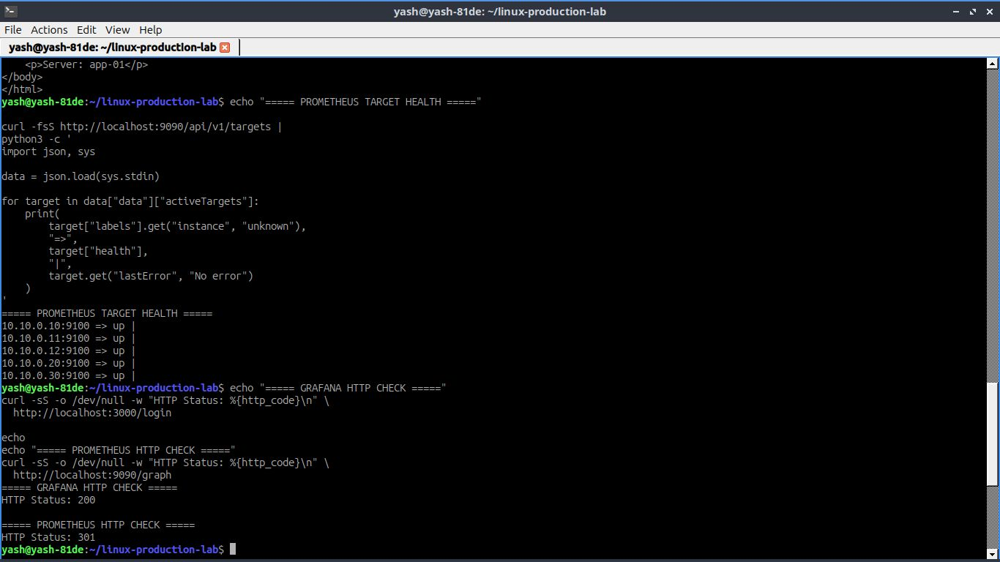

# Linux Production Environment & Incident Lab

A hands-on Linux infrastructure and operations lab built with Docker,
Terraform, Ansible, Prometheus, and Grafana.

The project models a small multi-node Linux environment and focuses on
infrastructure provisioning, configuration management, service operations,
monitoring, troubleshooting, and incident recovery.

> This is a local engineering lab, not a commercial production deployment.
> It uses privileged Docker containers running systemd rather than
> independent virtual machines.

## Project at a glance

| Area | Implementation |
|---|---|
| Infrastructure | Five Ubuntu 24.04 Linux containers |
| Provisioning | Terraform with the Docker provider |
| Networking | Private Docker bridge network |
| Configuration | Ansible playbooks and Jinja2 templates |
| Reverse proxy | Nginx |
| Application nodes | Two Linux application nodes |
| Metrics | Prometheus and Node Exporter |
| Dashboards | Grafana |
| Operations | SSH, systemd, Linux administration |
| Reliability practice | Troubleshooting records and incident exercises |

## Architecture

The lab uses a private Docker network named `production-net`
with the subnet `10.10.0.0/24`.

### Infrastructure nodes

| Node | Address | Responsibility |
|---|---|---|
| `nginx-01` | `10.10.0.10` | Nginx reverse proxy |
| `app-01` | `10.10.0.11` | Application service |
| `app-02` | `10.10.0.12` | Second application service |
| `db-01` | `10.10.0.20` | Linux infrastructure node |
| `monitoring-01` | `10.10.0.30` | Prometheus and Grafana |

`db-01` is currently a Linux infrastructure node; a database service is
not configured in this project.

## What this project demonstrates

### 1. Infrastructure provisioning
- Defining Docker networks and Linux containers through Terraform.
- Assigning static private IP addresses.
- Managing infrastructure resources through declarative configuration.
- Reviewing Terraform plans and understanding resource lifecycle.

### 2. Linux system administration
- Managing users, groups, permissions, and sudo access.
- Working with packages, processes, filesystems, and network utilities.
- Managing services with systemd.
- Configuring SSH access and troubleshooting connectivity.

### 3. Configuration management
- Using Ansible inventories to organize infrastructure nodes.
- Applying a common Linux administration baseline.
- Deploying application files and systemd services.
- Configuring Nginx, Prometheus, Grafana, and Node Exporter.
- Using Jinja2 templates for repeatable configuration.

### 4. Monitoring and observability
- Collecting Linux host metrics with Node Exporter.
- Scraping metrics with Prometheus.
- Querying metrics and investigating monitoring failures.
- Visualizing infrastructure metrics through Grafana.
- Troubleshooting filesystem metric collection and target health.

### 5. Incident response and troubleshooting
- Investigating high CPU utilization.
- Diagnosing missing filesystem metrics.
- Recovering monitoring services after container replacement.
- Troubleshooting Docker networking, DNS, SSH, systemd, and service failures.
- Recording investigation steps, remediation, and verification evidence.

## Technology stack

- **Linux:** Ubuntu 24.04, systemd, SSH, package and service management
- **Containers:** Docker Engine
- **Infrastructure as Code:** Terraform
- **Configuration Management:** Ansible
- **Reverse Proxy:** Nginx
- **Monitoring:** Prometheus and Node Exporter
- **Visualization:** Grafana
- **Templating:** Jinja2
- **Version Control:** Git and GitHub

## Repository guide

| Path | Purpose |
|---|---|
| `terraform/` | Infrastructure resources, variables, outputs, provider lock file |
| `docker/server/` | Ubuntu-based Linux server image |
| `ansible/inventory/` | Infrastructure host inventory |
| `ansible/playbooks/` | Linux baseline and service configuration |
| `ansible/templates/` | Jinja2 service and application templates |
| `ansible/files/` | Supporting deployment files, if present |
| `diagrams/` | Architecture diagram source |
| `docs/SETUP.md` | Installation and initial setup |
| `runbooks/OPERATIONS.md` | Routine checks, incident triage, and service recovery |
| `docs/incidents/` | Formal incident reports |
| `docs/linux-production-lab-troubleshooting-log.md` | Troubleshooting history and lessons learned |

## Documentation

- [Setup Guide](docs/SETUP.md) — prerequisites and initial deployment
- [Operations Runbook](runbooks/OPERATIONS.md) — health checks, troubleshooting, and recovery procedures
- [Troubleshooting Log](docs/linux-production-lab-troubleshooting-log.md) — practical debugging records
- [Incident: Missing Filesystem Metrics](docs/incidents/INC-001-missing-filesystem-metrics.md)
- [Incident: Monitoring Container Replacement](docs/incidents/INC-002-monitoring-container-replacement.md)
- [Incident: High CPU on app-01](docs/incidents/INC-003-high-cpu-app-01.md)
- [Architecture Diagram Source](diagrams/architecture.mmd)

## Monitoring and infrastructure evidence

The following screenshots capture the running Linux lab and its monitoring
configuration.

### Grafana Linux monitoring dashboard

Four panels showing CPU utilization, memory utilization, root filesystem
utilization, and network traffic across the five Linux nodes.

### Prometheus and service verification

Terminal evidence showing Prometheus target health and monitoring endpoint
checks.

### Infrastructure verification

Screenshot of the Linux lab environment and its operational verification.

## Scope and limitations

- Runs locally on a Linux host using Docker Engine.
- Uses privileged containers to support systemd and service administration.
- Does not provision independent virtual machines or cloud infrastructure.
- Does not currently configure a database service on `db-01`.
- The Docker subnet must not conflict with existing host or Docker networks.
- Monitoring persistence depends on host-mounted local directories.
- This lab is not hardened for public exposure and does not provide
  production-grade high availability or disaster recovery.

## Project status

The local infrastructure has been provisioned with Terraform, configured
with Ansible, and extended with Prometheus and Grafana monitoring.
Troubleshooting records and incident exercises document practical
investigation and recovery work.

The project demonstrates hands-on infrastructure learning and lab-based
operational practice; it is not presented as commercial production experience.
